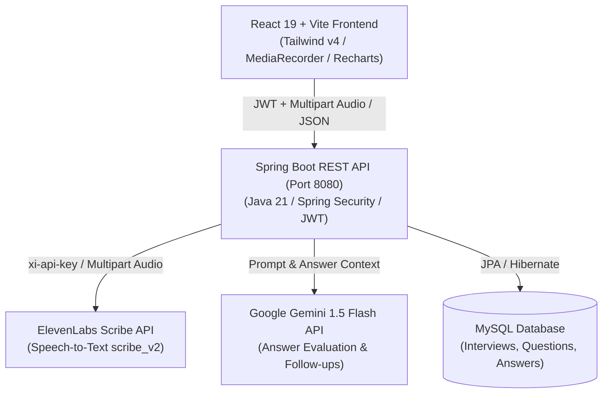

# IntervAI · AI Mock Interview & Career Coaching Platform

<div align="center">


[](https://vitejs.dev/)
[](https://react.dev/)
[](https://tailwindcss.com/)
[](https://spring.io/projects/spring-boot)
[](https://openjdk.org/)
[](https://elevenlabs.io/)
[](https://ai.google.dev/)
[](https://www.mysql.com/)
[](LICENSE)

**Everything you need to ace your technical, system design, and behavioral interviews.**  
_High-accuracy speech-to-text with ElevenLabs Scribe, multi-dimensional Gemini AI evaluation, adaptive follow-ups, and ATS resume intelligence._

[Report Bug](https://github.com/aaryanman29-beep/IntervAI/issues) · [Request Feature](https://github.com/aaryanman29-beep/IntervAI/issues)

</div>

---

## 📌 Overview

**IntervAI** is a full-stack, enterprise-grade mock interview coaching application modeled after leading tech prep platforms (such as Aced.io / Exponent). It bridges the gap between static practice problems and actual high-pressure interview loops by pairing real-time voice recording and ElevenLabs Speech-to-Text transcription with Google Gemini generative evaluation.

Whether preparing for **Software Engineering, System Design, Product Management, Machine Learning, or Engineering Leadership**, IntervAI provides realistic mock loops, adaptive follow-ups, and step-by-step career roadmaps.

---

## ✨ Key Features

- **🎙️ Real-Time Audio Recording & ElevenLabs Scribe Speech-to-Text**
  - In-browser microphone capture using HTML5 MediaRecorder API with real-time waveform activity display.
  - Candidate recording playback preview and instant discard/re-record capability.
  - Server-side multipart audio submission (`POST /api/interviews/transcribe`) with secure rate limiting and audio validation.
  - Powered by **ElevenLabs Speech-to-Text (`scribe_v2`)** for industry-leading accuracy across technical vocabulary, accents, and complex phrasing.
  - Graceful fallback for local development when credentials are not configured.

- **🤖 Adaptive AI Interviewer (Powered by Gemini AI)**
  - Evaluates candidate answers in real-time across four distinct dimensions:
    - **Technical Correctness**
    - **Communication Clarity**
    - **Depth & Edge Case Handling**
    - **Structured Delivery**
  - **Dynamic Follow-ups**: If your answer introduces a trade-off or needs clarification, the AI immediately asks an adaptive follow-up prompt.
  - Decoupled architecture: speech transcription persists even if evaluation services experience momentary external timeouts.

- **📄 ATS Resume Intelligence & Skill Extraction**
  - Upload PDF/DOCX resumes to identify technical skills, experience gaps, and compute ATS parse compatibility.
  - Generates custom interview loops targeted directly at your project history.

- **📊 Comprehensive Scorecards & Skill Breakdown**
  - Visual metrics, radar charts, strengths/weaknesses breakdown, and model reference answers.

- **🎯 Curated Question Bank**
  - Searchable by topic, difficulty (_Easy, Medium, Hard_), and track (_System Design, Algorithms, Behavioral, SQL, Machine Learning_).
  - Personal bookmarking and practice state management.

- **✨ Premium UI & Micro-Animations**
  - **Dynamic 3D Word Rotator**: Smooth perspective-flip animated headline cycling through practice disciplines.
  - **Endless Horizontal Marquee**: Continuous GPU-accelerated social proof ticker with hover-to-pause and edge fade masks.
  - **Ambient Pulsing Glow Orbs & Shimmer Badges**: Modern visual depth without performance compromise.
  - **Live Audio Wave Equalizer**: Real-time microphone audio activity indicator in interview sessions.

- **🛡️ Multi-Pillar Production Security Architecture**
  1. **Zero Client Secrets**: All API keys (`ELEVENLABS_API_KEY`, `GEMINI_API_KEY`) and secrets (`JWT_SECRET`) reside exclusively server-side.
  2. **Server-Side Business Logic**: Answer evaluations, transcription handling, scoring heuristics, and ATS parsing run securely in backend services.
  3. **Strict Authentication & Authorization**: Stateless JWT verification with per-resource session ownership validation.
  4. **Multi-Tier Rate Limiting & Abuse Protection**:
     - _Speech-to-Text Transcription_: Rate limited per user session to prevent API quota drain.
     - _Login/Register_: Max 5 attempts/min per IP (mitigates credential stuffing/brute force).
     - _Account Lockout_: Auto-lock after consecutive failed login attempts.
     - _Interview Loops_: Max 5 creations / 10 minutes.
     - _AI Evaluations_: Rate-governed AI evaluation execution.
  5. **Input & Upload Validation**: Audio file validation (MIME type, size caps up to 25MB), Jakarta Bean Validation (`@Valid`, `@Pattern`), and PDF magic byte verification.
  6. **Private Internal Database Network**: MySQL container isolated on an internal bridge network.
  7. **Server-Authoritative Decisions**: Scores (0–100) and roadmap progressions calculated purely server-side.
  8. **HTTPS/TLS & Hardened Headers**: HSTS, CSP, X-Frame-Options (`SAMEORIGIN`), X-Content-Type-Options (`nosniff`).

---

## 🏗️ Architecture & Tech Stack



### Frontend

- **Framework**: React 19 + Vite 8
- **Audio Capture**: Browser MediaRecorder API with live duration, playback preview, and error fallback
- **Styling**: Tailwind CSS v4
- **Typography**: Inter (Body) + Plus Jakarta Sans (Headings) + JetBrains Mono (Code)
- **Icons**: Lucide React
- **Data Visualization**: Recharts
- **Testing**: Vitest + React Testing Library + JSDOM

### Backend

- **Framework**: Spring Boot 4.1.1 (Java 21)
- **Security**: Spring Security 7 + JWT + BCrypt + Sliding Window Rate Limiting
- **Speech-to-Text**: ElevenLabs Scribe API (`scribe_v2`)
- **AI Evaluation**: Google Gemini 1.5 Flash API via Spring RestTemplate + Jackson
- **Database**: MySQL with Flyway Database Versioning
- **Build Tool**: Maven (`mvnw` wrapper included)
- **Testing**: JUnit 5 + Mockito + Spring Boot Test (27 unit/integration tests)

---

## 🚀 Quick Start Guide

### Prerequisites

- **Node.js**: `v20.x` or `v22.x` (npm or pnpm)
- **Java**: OpenJDK `21`
- **MySQL**: `8.x`, `9.x`, or `26.x`
- **ElevenLabs API Key**: [ElevenLabs Dashboard](https://elevenlabs.io/) (for speech-to-text)
- **Gemini API Key**: [Google AI Studio](https://aistudio.google.com/) (for interview evaluation)

---

### 1. Clone Repository

```bash
git clone https://github.com/aaryanman29-beep/IntervAI.git
cd IntervAI
```

---

### 2. Configure Backend

Create an environment file or export variables:

```bash
# In backend/src/main/resources/application.yml or system environment
export SPRING_DATASOURCE_URL="jdbc:mysql://localhost:3306/intervAI?useSSL=false&allowPublicKeyRetrieval=true&serverTimezone=Asia/Kolkata"
export SPRING_DATASOURCE_USERNAME="root"
export SPRING_DATASOURCE_PASSWORD="YourPassword"
export JWT_SECRET="your-256-bit-hex-secret-key-at-least-64-characters-long"
export GEMINI_API_KEY="your-gemini-api-key"
export ELEVENLABS_API_KEY="your-elevenlabs-api-key"
export ELEVENLABS_STT_MODEL_ID="scribe_v2"
```

Start the backend:

```bash
cd backend
./mvnw clean spring-boot:run
```

_Backend runs on `http://localhost:8080`._

---

### 3. Configure Frontend

In the root directory, configure `.env.local`:

```bash
VITE_API_URL=http://localhost:8080/api
```

Install dependencies and start development server:

```bash
npm install
npm run dev
```

_Frontend runs on `http://localhost:8443` (or `http://localhost:5173`)._

---

## 🧪 Testing

### Frontend Tests

```bash
npm run test
```

_Executes all unit and component tests (including MediaRecorder flow, transcription submit, retry, and UI controls) via Vitest._

### Backend Tests

```bash
cd backend
./mvnw test
```

_Runs all 27 unit and integration tests including ElevenLabsSttService, InterviewService, and Spring Security validation._

---

## 🐳 Docker Deployment

A multi-stage `Dockerfile` and `docker-compose.yml` are provided for containerized deployment:

```bash
docker compose up -d --build
```

This spins up:

- **`intervai-frontend`**: Production NGINX web server serving optimized Vite bundle.
- **`intervai-backend`**: Spring Boot container on port `8080`.
- **`intervai-db`**: MySQL container with persistent volume and health check.

---

## 🔒 Security & Privacy

- **CORS Configuration**: Restricts access to authorized frontend origins.
- **Credential Safety**: All AI provider API keys remain server-side; zero keys are baked into client bundles.
- **Data Protection**: Passwords hashed with BCrypt (cost factor 10); stateless JWT auth.
- **Rate Limiting**: Custom token bucket rate limiters prevent API and transcription abuse.
- **Audio Privacy**: Audio clips are streamed securely for real-time transcription without persistent unencrypted audio storage.

---

## 🤝 Contributing

Contributions are always welcome!

1. Fork the Project.
2. Create your Feature Branch (`git checkout -b feature/AmazingFeature`).
3. Commit your Changes (`git commit -m 'feat: add AmazingFeature'`).
4. Push to the Branch (`git push origin feature/AmazingFeature`).
5. Open a Pull Request.

---

## 📄 License

Distributed under the MIT License. See `LICENSE` for more information.

---

<div align="center">
  <sub>Built with ❤️ by <a href="https://github.com/aaryanman29-beep">Aaryan</a> and the IntervAI Team. Practice with confidence.</sub>
</div>
