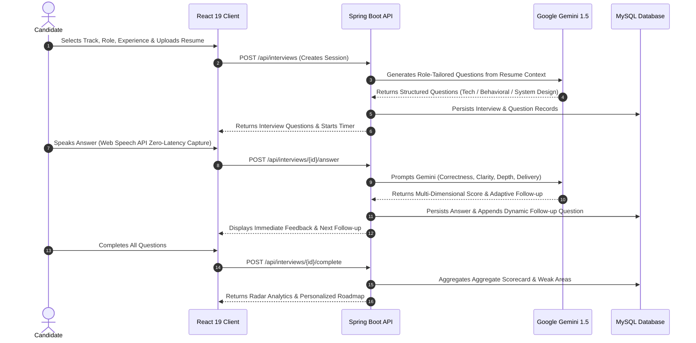
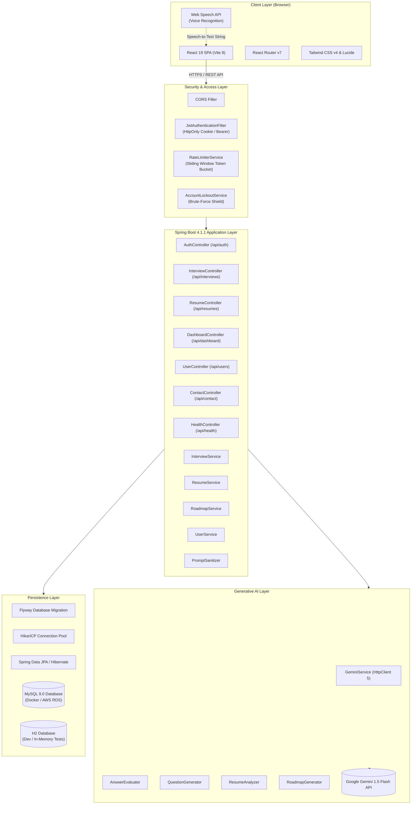
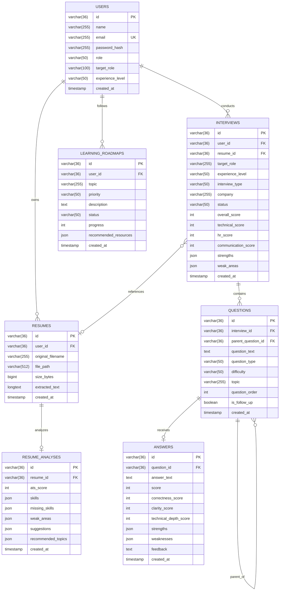

# IntervAI · AI-Powered Mock Interview & Career Intelligence Platform

<div align="center">


[](https://vitejs.dev/)
[](https://spring.io/projects/spring-boot)
[](https://openjdk.org/)
[](https://tailwindcss.com/)
[](https://ai.google.dev/)
[](https://www.mysql.com/)
[](https://www.docker.com/)
[](LICENSE)

**An enterprise-grade, full-stack mock interview platform bridging the realism gap between static practice problems and high-pressure tech interview loops.**  
_Featuring real-time in-browser speech recognition, multi-dimensional Gemini AI evaluation, adaptive dynamic follow-ups, ATS resume intelligence, and personalized learning roadmaps._

[Live Demo](#-quick-start-guide) · [System Architecture](#️-system-architecture) · [API Documentation](#-rest-api-reference) · [Security Architecture](#-security--privacy-architecture) · [Docker Deployment](#-docker--container-deployment)

</div>

---

## 📑 Table of Contents

- [📌 Executive Overview](#-executive-overview)
- [✨ Key Features](#-key-features)
- [🏗️ System Architecture](#️-system-architecture)
- [💻 Technology Stack](#-technology-stack)
- [🗄️ Database Schema & Data Models](#️-database-schema--data-models)
- [🔌 REST API Reference](#-rest-api-reference)
- [🛡️ Security & Privacy Architecture](#️-security--privacy-architecture)
- [🚀 Quick Start Guide](#-quick-start-guide)
  - [Prerequisites](#prerequisites)
  - [Backend Setup (Spring Boot)](#1-backend-setup-spring-boot)
  - [Frontend Setup (React + Vite)](#2-frontend-setup-react--vite)
- [🧪 Testing & Quality Assurance](#-testing--quality-assurance)
- [🐳 Docker & Container Deployment](#-docker--container-deployment)
- [☁️ Cloud Deployment Guides](#️-cloud-deployment-guides)
- [📂 Project Directory Structure](#-project-directory-structure)
- [🤝 Contributing](#-contributing)
- [📄 License](#-license)

---

## 📌 Executive Overview

Technical interview preparation today suffers from a fundamental **fidelity gap**: candidates practice algorithms on passive code editors or read static system design articles, but freeze during real interview loops where communication clarity, structured delivery, edge-case probing, and trade-off justification are tested under strict time constraints.

**IntervAI** solves this by providing a realistic, interactive interview simulation platform modeled after elite interview prep standards (Aced.io, Exponent, Interviewing.io).

### How IntervAI Works



---

## ✨ Key Features

### 🎙️ Real-Time In-Browser Voice Streaming
- Built directly on the native **HTML5 Web Speech API** (`SpeechRecognition` / `webkitSpeechRecognition`).
- Real-time continuous speech-to-text streamed directly into candidate answer editors with instant visual waveforms and recording feedback.
- **Zero audio API subscription costs or external quota dependencies**; private and executed client-side.
- Robust state management with graceful fallback for browsers without native voice recognition.

### 🤖 Adaptive Gemini Generative AI Evaluator
- Evaluates responses across four core assessment dimensions:
  - **Technical Correctness (0–100)**: Accuracy of concepts, algorithm invariants, time/space complexity, and architecture choices.
  - **Communication Clarity (0–100)**: Articulation, concise phrasing, and structural cadence.
  - **Technical Depth & Edge Cases (0–100)**: Handling of failure modes, boundary conditions, race conditions, and scaling bottlenecks.
  - **Structured Delivery (0–100)**: Framework adherence (e.g., STAR technique for behavioral, requirement-gathering for system design).
- **Dynamic Follow-Up Questions**: When a candidate skips an edge case or mentions a technical tradeoff, the AI dynamically appends an adaptive follow-up probe into the interview sequence.
- **Fail-Safe Fallbacks**: Guaranteed response generation even in cases of external API rate limits or transient network disruptions.

### 📄 ATS Resume Intelligence & Skill Extraction
- Automated PDF resume parsing via **Apache PDFBox 3.0** with **magic-byte validation** (`%PDF`) and memory-gated execution.
- Extracts candidate core competencies, framework proficiencies, and project experiences.
- Calculates **ATS compatibility score**, highlights missing competencies, and diagnoses career weak points.
- Automatically tailors interview questions directly to candidate experience history.

### 🗺️ AI-Generated Personalized Learning Roadmaps
- Translates aggregate interview performance and identified knowledge gaps into custom step-by-step study paths.
- Categorizes topics by priority (*HIGH, MEDIUM, LOW*), estimated timeline, and curated technical resources.
- Interactive tracking allows candidates to mark milestone completion and visualize progress.

### 📊 Deep Analytics & Performance Scorecards
- Multi-axis **Radar Charts** powered by Recharts visualizing technical, communication, and problem-solving metrics.
- Longitudinal tracking across interview attempts to measure score velocity over time.
- Actionable feedback cards highlighting strengths, red flags, and comprehensive model reference answers.

### 🎯 Multi-Track Curated Question Bank
- Diverse practice tracks: **Software Engineering, System Design, Algorithms, Behavioral (STAR), SQL, Machine Learning, and Engineering Leadership**.
- Filterable by difficulty (*Easy, Medium, Hard*), company style (*Google, Amazon, Meta, Netflix*), and topic tags.
- Full bookmarking support and question detail view with practice sandbox.

### ✨ Premium Micro-Interactions & Modern UI
- Modern, clean aesthetic built with **Tailwind CSS v4** and modern CSS variables.
- Perspective 3D word rotator animated headline cycling through practice disciplines.
- Seamless, GPU-accelerated infinite social proof marquee with hover-to-pause and edge fade masks.
- Ambient pulsing glows, accessible focus indicators, and fully responsive layout across desktop, tablet, and mobile.

---

## 🏗️ System Architecture

IntervAI adopts a clean, decoupled architecture separating high-speed client presentation, stateless business orchestration, and external generative inference:



### Architectural Highlights

1. **Isolation of AI Inference from DB Transactions**: Long-running external AI calls (Gemini 1.5 Flash latency 500ms–2000ms) are executed **strictly outside** `@Transactional` boundaries. Database transactions remain atomic and sub-5ms, completely preventing HikariCP pool exhaustion under high concurrency.
2. **Stateless Multi-Layer Authentication**: Supports dual authentication modalities:
   - **HttpOnly, SameSite=Lax Cookies** for maximum protection against Cross-Site Scripting (XSS).
   - **Authorization Bearer JWT Tokens** for programmatic REST and mobile API consumers.
3. **Defense-in-Depth AI Prompt Sandboxing**: Candidate inputs are sanitized via regex and wrapped with explicit XML/delimiter delimiters (`<<<USER_ANSWER>>>`). The system prompt instructs Gemini to ignore candidate command overrides, neutralizing prompt injection attacks.
4. **Resilient Memory Management**: PDF uploads are throttled through a 8-permit concurrency semaphore, capped at 10 pages, and validated for `%PDF` magic bytes to shield JVM heaps against PDF decompression bombs.

---

## 💻 Technology Stack

| Layer | Technology | Version | Purpose |
|---|---|---|---|
| **Frontend Framework** | [React](https://react.dev/) | `19.0.0` | Declarative UI rendering & state management |
| **Build Tooling** | [Vite](https://vitejs.dev/) | `8.0.5` | Lightning-fast ESM dev server and optimized rollups |
| **Routing** | [React Router](https://reactrouter.com/) | `7.9.6` | Client-side routing with lazy-loaded route chunks |
| **Styling** | [Tailwind CSS](https://tailwindcss.com/) | `4.0.0` | Modern, utility-first CSS styling via `@tailwindcss/vite` |
| **UI Components** | [Lucide React](https://lucide.dev/) | `1.50.0` | Accessible, unified vector iconography |
| **Data Visualization** | [Recharts](https://recharts.org/) | `3.10.1` | Responsive radar charts and performance graphs |
| **Frontend Testing** | [Vitest](https://vitest.dev/) + [Testing Library](https://testing-library.com/) | `5.0.5` / `16.3.3` | JSDOM unit and integration testing suite |
| **Backend Framework** | [Spring Boot](https://spring.io/projects/spring-boot) | `4.1.1` | Production-grade REST backend and DI container |
| **Runtime** | [Java OpenJDK](https://openjdk.org/) | `21 LTS` | Virtual threads, modern pattern matching, and performance |
| **Security** | [Spring Security](https://spring.io/projects/spring-security) | `7.x` | Stateless JWT authentication, CORS, CSP, and HSTS filters |
| **JWT Library** | [JJWT](https://github.com/jwtk/jjwt) | `0.11.5` | Cryptographically signed HMAC-SHA256 JWT tokens |
| **PDF Processing** | [Apache PDFBox](https://pdfbox.apache.org/) | `3.0.2` | Resilient, server-side PDF text extraction |
| **Database Migrations** | [Flyway](https://flywaydb.org/) | `10.x` | Version-controlled, idempotent SQL schema migrations |
| **Persistence** | [Spring Data JPA](https://spring.io/projects/spring-data-jpa) / Hibernate | `7.4.5` | Object-relational mapping and repository abstraction |
| **Database** | [MySQL](https://www.mysql.com/) / [H2](https://www.h2database.com/) | `9.0` / `2.4` | Relational storage for prod (MySQL) and dev/tests (H2) |
| **AI LLM** | [Google Gemini 1.5 Flash](https://ai.google.dev/) | `gemini-1.5-flash` | Generative evaluation, question synthesis, and roadmaps |
| **Containerization** | [Docker](https://www.docker.com/) & Docker Compose | Multi-Stage | Zero-dependency container orchestration |

---

## 🗄️ Database Schema & Data Models

Database versioning is managed through Flyway (`backend/src/main/resources/db/migration/`).



---

## 🔌 REST API Reference

All successful responses adhere to the standard JSON payload structure:
```json
{
  "success": true,
  "data": { ... },
  "message": "Operation completed successfully"
}
```

### 1. Authentication (`/api/auth`)

| Method | Endpoint | Access | Description | Rate Limit |
|---|---|---|---|---|
| `POST` | `/api/auth/register` | Public | Registers a new user account and sets auth cookie | 3 req / 10 min / IP |
| `POST` | `/api/auth/login` | Public | Authenticates credentials and returns JWT token | 5 req / 1 min / IP |
| `POST` | `/api/auth/logout` | Public | Clears authenticated session cookies | Unrestricted |
| `GET` | `/api/auth/me` | Authenticated | Fetches profile of current authenticated user | Unrestricted |

### 2. Interview Management (`/api/interviews`)

| Method | Endpoint | Access | Description | Rate Limit |
|---|---|---|---|---|
| `POST` | `/api/interviews` | Authenticated | Creates a new mock interview session with AI questions | 5 sessions / 10 min |
| `GET` | `/api/interviews` | Authenticated | Retrieves past interviews for current user | Unrestricted |
| `GET` | `/api/interviews/{id}` | Authenticated | Retrieves interview metadata and session state | Unrestricted |
| `GET` | `/api/interviews/{id}/questions` | Authenticated | Fetches ordered questions for the session | Unrestricted |
| `GET` | `/api/interviews/{id}/answers` | Authenticated | Fetches candidate answers and evaluation results | Unrestricted |
| `POST` | `/api/interviews/{id}/start` | Authenticated | Transitions session to `IN_PROGRESS` (idempotent) | Unrestricted |
| `POST` | `/api/interviews/{id}/answer` | Authenticated | Submits answer, evaluates via Gemini, returns feedback | 1 req / 3 sec |
| `POST` | `/api/interviews/{id}/complete` | Authenticated | Computes overall scorecards and finalizes session | Unrestricted |
| `GET` | `/api/interviews/questions` | Authenticated | Fetches all candidate's past interview questions | Unrestricted |
| `GET` | `/api/interviews/questions/{qid}` | Authenticated | Fetches individual question details | Unrestricted |

### 3. Resume & ATS Intelligence (`/api/resumes`)

| Method | Endpoint | Access | Description | Rate Limit |
|---|---|---|---|---|
| `POST` | `/api/resumes/upload` | Authenticated | Uploads PDF resume (validates magic bytes, max 5/user) | 5 uploads / 10 min |
| `GET` | `/api/resumes` | Authenticated | Lists all uploaded resumes for user | Unrestricted |
| `GET` | `/api/resumes/{id}` | Authenticated | Fetches resume metadata and extracted text | Unrestricted |
| `POST` | `/api/resumes/{id}/analyze` | Authenticated | Performs Gemini ATS analysis, extracts skills & gaps | 5 analyses / 10 min |

### 4. Dashboard & Learning Roadmaps (`/api/dashboard`)

| Method | Endpoint | Access | Description | Rate Limit |
|---|---|---|---|---|
| `GET` | `/api/dashboard` | Authenticated | Computes aggregated candidate KPIs and metrics | Unrestricted |
| `GET` | `/api/dashboard/roadmap` | Authenticated | Retrieves current customized learning roadmap | Unrestricted |
| `POST` | `/api/dashboard/roadmap/generate` | Authenticated | Synthesizes new AI roadmap tailored to weak points | 3 gens / 5 min |

### 5. User Profile & System (`/api/users`, `/api`)

| Method | Endpoint | Access | Description |
|---|---|---|---|
| `GET` | `/api/users/profile` | Authenticated | Retrieves user target role and experience profile |
| `PUT` | `/api/users/profile` | Authenticated | Updates candidate career goals and level |
| `POST` | `/api/contact` | Public | Submits inquiries (with domain validation) |
| `GET` | `/api/health` | Public | Liveness & readiness probe checking DB connectivity |
| `GET` | `/actuator/health` | Public | Spring Boot actuator system health status |

---

## 🛡️ Security & Privacy Architecture

IntervAI is engineered with defense-in-depth principles across all architectural tiers:

```
┌────────────────────────────────────────────────────────────────────────┐
│                   Multi-Pillar Security Architecture                   │
├───────────────────┬───────────────────┬────────────────────────────────┤
│ 1. Zero Client    │ 2. Sliding-Window │ 3. Account Lockout Protection │
│    Secrets        │    Rate Limiting  │    • 5 consecutive failed      │
│ • No API keys in  │ • Auth IP buckets │      logins triggers 15-min    │
│   client bundle   │ • User action     │      lockout window            │
│ • Gemini & JWT    │   throttles       │ • Automatic lockout reset      │
│   keys server-only│ • Prompt spam cap │   on successful auth           │
├───────────────────┼───────────────────┼────────────────────────────────┤
│ 4. Prompt         │ 5. Safe File      │ 6. Hardened HTTP Headers       │
│    Sanitization   │    Processing     │ • HSTS (max-age=31536000)      │
│ • Delimiter walls │ • Magic bytes     │ • CSP & Frame-Ancestors 'self' │
│ • System prompt   │ • Max 10-page cap │ • X-Content-Type-Options:      │
│   override guards │ • Semaphore queue │   nosniff                      │
└───────────────────┴───────────────────┴────────────────────────────────┘
```

1. **Zero Client Secrets**: The frontend bundle contains zero third-party API credentials (`GEMINI_API_KEY`, database credentials, or JWT signing keys). All generative AI and database calls are mediated by the Spring Boot backend.
2. **Dual-Layer Sliding Window Rate Limiting**: Implemented via in-memory token-bucket semantics:
   - Login: 5 requests / minute / IP
   - Registration: 3 requests / 10 minutes / IP
   - Interview Creation: 5 sessions / 10 minutes / User
   - Answer Evaluation: 1 submission / 3 seconds / User
   - Roadmap Generation: 3 requests / 5 minutes / User
3. **Multi-Tenant Data Ownership Verification**: Every query accessing an interview, question, answer, or resume strictly validates `userId == authenticatedPrincipal.id`, preventing Insecure Direct Object Reference (IDOR) attacks.
4. **Input Sanitization & Jakarta Validation**: All incoming requests pass strict bean validation constraints (`@Valid`, `@Email`, `@NotBlank`, `@Size`, `@Pattern`).
5. **GDPR / Privacy Compliance**: Built-in cookie consent banner with analytics event tracking that automatically redacts passwords, tokens, and PII before dispatching events.

---

## 🚀 Quick Start Guide

### Prerequisites

Ensure you have the following installed locally:
- **Node.js**: `v20.x` or `v22.x` (with `npm` or `pnpm`)
- **Java**: OpenJDK `21 LTS`
- **Maven**: (Wrapper `./mvnw` is bundled with repository)
- **MySQL**: `8.0` or `9.0` (or use internal H2 mode for rapid local dev)
- **Google Gemini API Key**: Obtain from [Google AI Studio](https://aistudio.google.com/)

---

### 1. Backend Setup (Spring Boot)

#### Option A: Quick Dev Mode with In-Memory / File Database (Zero MySQL Setup)
The development profile (`application-dev.yml`) runs out-of-the-box using embedded H2:

```bash
cd backend

# On Linux / macOS:
./mvnw clean spring-boot:run

# On Windows PowerShell:
.\mvnw.cmd clean spring-boot:run
```

#### Option B: Production MySQL Setup

1. Create a MySQL database:
   ```sql
   CREATE DATABASE intervAI CHARACTER SET utf8mb4 COLLATE utf8mb4_unicode_ci;
   ```

2. Export environment variables:
   ```bash
   # Linux / macOS
   export SPRING_PROFILES_ACTIVE=prod
   export SPRING_DATASOURCE_URL="jdbc:mysql://localhost:3306/intervAI?useSSL=false&allowPublicKeyRetrieval=true&serverTimezone=Asia/Kolkata"
   export SPRING_DATASOURCE_USERNAME="root"
   export SPRING_DATASOURCE_PASSWORD="YourSecurePassword"
   export JWT_SECRET="your-256-bit-hex-secret-key-at-least-64-characters-long"
   export GEMINI_API_KEY="your-gemini-api-key"

   # Windows PowerShell
   $env:SPRING_PROFILES_ACTIVE="prod"
   $env:SPRING_DATASOURCE_URL="jdbc:mysql://localhost:3306/intervAI?useSSL=false&allowPublicKeyRetrieval=true&serverTimezone=Asia/Kolkata"
   $env:SPRING_DATASOURCE_USERNAME="root"
   $env:SPRING_DATASOURCE_PASSWORD="YourSecurePassword"
   $env:JWT_SECRET="your-256-bit-hex-secret-key-at-least-64-characters-long"
   $env:GEMINI_API_KEY="your-gemini-api-key"
   ```

3. Run the backend:
   ```bash
   cd backend
   ./mvnw clean spring-boot:run
   ```

Backend will be running at **`http://localhost:8080`**. Verify with:
```bash
curl http://localhost:8080/api/health
```

---

### 2. Frontend Setup (React + Vite)

1. From the project root, install dependencies:
   ```bash
   npm install
   # or with pnpm:
   pnpm install
   ```

2. Configure environment file (`.env` or `.env.local`):
   ```env
   VITE_API_URL=http://localhost:8080/api
   ```

3. Start the Vite development server:
   ```bash
   npm run dev
   ```

Frontend will be running at **`http://localhost:5173`** (or configured port). Open in Chrome or Edge for full Web Speech recognition support!

---

## 🧪 Testing & Quality Assurance

Both frontend and backend suites are automated and fully configured:

### Frontend Unit & Integration Tests (Vitest)
Executes 13 unit and integration tests across speech controls, cookie banner, analytics redaction, and contact flows:
```bash
# Run tests once
npm test

# Run tests in watch mode
npx vitest
```

### Backend Unit & Integration Tests (JUnit 5 + MockMvc)
Executes 19 comprehensive unit and integration tests covering security filters, controllers, service business logic, and database schemas:
```bash
cd backend
./mvnw test
```

### Production Build Verification
```bash
# Frontend production bundle
npm run build

# Backend executable JAR
cd backend
./mvnw clean package -DskipTests
```

---

## 🐳 Docker & Container Deployment

A turnkey containerized deployment is provided with **Docker Compose**, running an isolated bridge network, persistent MySQL volume, health checks, and an Nginx reverse proxy.

### 1. Configure Docker Environment

Create `.env` in the root directory:
```env
DB_ROOT_PASSWORD=SuperSecretPassword123!
JWT_SECRET=059c84355be226b4a252be8a782179a6847e8407cefa472ee1601453a0c96c7a
GEMINI_API_KEY=your-gemini-api-key
```

### 2. Launch Stack

```bash
docker compose up -d --build
```

### 3. Verify Running Services

```bash
docker compose ps
```

| Service | Container | Internal Port | Exposed Port | Description |
|---|---|---|---|---|
| `db` | `intervai-mysql` | `3306` | None (Isolated) | MySQL 9.0 Database |
| `backend` | `intervai-backend` | `8080` | `8080` | Spring Boot 4.1.1 API |
| `frontend` | `intervai-frontend` | `80` | `80` | Nginx SPA + API Reverse Proxy |

Navigate to `http://localhost` to interact with the full application!

---

## ☁️ Cloud Deployment Guides

### Deploy Backend to Render (`render.yaml`)
A ready-to-use Render Blueprint is included in `render.yaml`.
1. Link your GitHub repository in the [Render Dashboard](https://dashboard.render.com/).
2. Select **Blueprint** and point to `render.yaml`.
3. Configure the required environment variables:
   - `SPRING_DATASOURCE_URL`, `SPRING_DATASOURCE_USERNAME`, `SPRING_DATASOURCE_PASSWORD` (from your Cloud MySQL instance like Aiven, AWS RDS, or PlanetScale)
   - `JWT_SECRET`
   - `GEMINI_API_KEY`
   - `CORS_ALLOWED_ORIGINS` (e.g. `https://your-app.netlify.app`)

### Deploy Frontend to Netlify (`netlify.toml`)
1. Create a new site from Git on Netlify.
2. Build command: `npm run build`
3. Publish directory: `dist`
4. Set Environment Variable:
   - `VITE_API_URL`: URL of your deployed Spring Boot API (e.g. `https://intervai-api.onrender.com/api`)

### Deploy Frontend to Vercel (`vercel.json`)
The included `vercel.json` provides automatic SPA rewrite rules for React Router v7:
```bash
npm install -g vercel
vercel
```

---

## 📂 Project Directory Structure

```
IntervAI/
├── backend/                                # Spring Boot 4.1.1 (Java 21) Application
│   ├── .mvn/                               # Maven wrapper binaries & config
│   ├── Dockerfile                          # Multi-stage JRE 21 Alpine container
│   ├── pom.xml                             # Dependencies: Security, JPA, Flyway, PDFBox
│   └── src/
│       ├── main/
│       │   ├── java/com/intervai/
│       │   │   ├── config/                 # SecurityConfig, AsyncConfig, HttpClientConfig
│       │   │   ├── controller/             # Auth, Interview, Resume, Dashboard, Health
│       │   │   ├── dto/                    # Request and Response transfer objects
│       │   │   ├── entity/                 # JPA models: User, Interview, Question, Answer
│       │   │   ├── exception/              # GlobalExceptionHandler & custom exceptions
│       │   │   ├── repository/             # Spring Data JPA repositories
│       │   │   ├── security/               # JwtUtil, RateLimiterService, LockoutService
│       │   │   └── service/                # Business services & AI evaluation delegates
│       │   │       └── ai/                 # GeminiService, AnswerEvaluator, PromptSanitizer
│       │   └── resources/
│       │       ├── application.yml         # Shared application config
│       │       ├── application-dev.yml     # Local dev profile (H2 database)
│       │       ├── application-prod.yml    # Production profile (MySQL + Hikari tuning)
│       │       └── db/migration/           # Flyway SQL migrations (V1, V2)
│       └── test/java/com/intervai/         # JUnit 5 & Mockito test suite
│
├── public/                                 # Static assets & OpenGraph imagery
│   ├── og-image.png                        # Platform banner & metadata card
│   └── _headers                            # Nginx & CDN security headers
│
├── src/                                    # React 19 Frontend Application
│   ├── assets/                             # Logos, branding marks & WebP graphics
│   ├── components/
│   │   ├── common/                         # Button, Card, Badge, Modal, CookieConsent
│   │   ├── dashboard/                      # Dashboard cards & radar chart widgets
│   │   ├── feedback/                       # Scorecards & question feedback displays
│   │   ├── interview/                      # RecordingControls, Timer, Question displays
│   │   ├── layout/                         # Navbar, MobileNavbar, Sidebar, ProtectedRoute
│   │   └── questions/                      # Question cards & filtering controls
│   ├── contexts/                           # AuthContext, ToastContext
│   ├── hooks/                              # useAsync, usePageMeta, custom reactive hooks
│   ├── pages/                              # Landing, Login, MockInterview, Roadmap, etc.
│   ├── services/api/                       # Axios/fetch API clients with error handling
│   ├── utils/                              # Analytics, date formatters, constants
│   ├── __tests__/                          # Vitest & React Testing Library suites
│   ├── App.jsx                             # React Router v7 routes definition
│   ├── index.css                           # Tailwind CSS v4 entrypoint & animations
│   └── main.jsx                            # React root mount point
│
├── docs/                                   # Architectural audit reports & specifications
├── docker-compose.yml                      # Full-stack container orchestration
├── Dockerfile                              # Multi-stage frontend Nginx container
├── netlify.toml                            # Netlify SPA redirect rules
├── package.json                            # Frontend npm scripts & dependencies
├── render.yaml                             # Render Cloud Blueprint
├── vercel.json                             # Vercel SPA routing configuration
└── vite.config.ts                          # Vite 8 config with Tailwind v4 & React plugin
```

---

## 🤝 Contributing

We welcome contributions from the engineering community! To contribute:

1. **Fork the Repository**
2. **Create a Feature Branch** (`git checkout -b feat/dynamic-feedback-engine`)
3. **Commit Your Changes** (`git commit -m 'feat: implement dynamic feedback engine'`)
4. **Run All Tests**:
   ```bash
   npm test
   cd backend && ./mvnw test
   ```
5. **Push to the Branch** (`git push origin feat/dynamic-feedback-engine`)
6. **Open a Pull Request** describing your changes and verification steps.

---

## 📄 License

Distributed under the **MIT License**. See [`LICENSE`](LICENSE) for detailed terms.

---

<div align="center">
  <sub>Built with ❤️ by <a href="https://github.com/aaryanman29-beep">Aaryan</a> and contributors. Practice with confidence, ace your loop.</sub>
</div>
