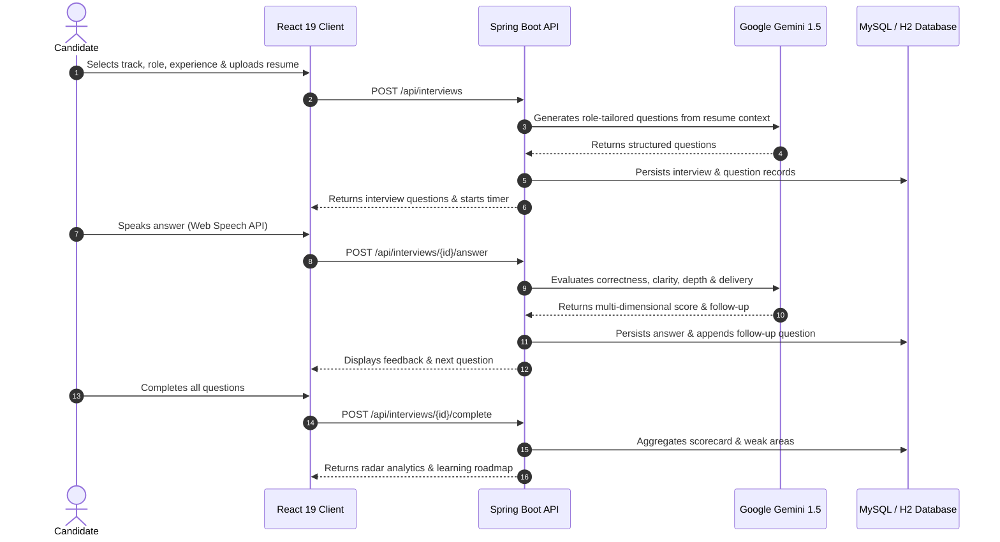
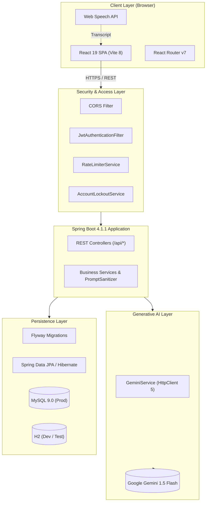

# IntervAI

<div align="center">


[](https://vitejs.dev/)
[](https://spring.io/projects/spring-boot)
[](https://openjdk.org/)
[](https://tailwindcss.com/)
[](https://ai.google.dev/)
[](https://www.mysql.com/)
[](https://www.docker.com/)

**A full-stack, AI-powered mock interview and career intelligence platform.**  
*Real-time in-browser speech recognition, multi-dimensional Gemini AI evaluation, adaptive follow-up questions, ATS resume analysis, and personalized learning roadmaps.*

[Overview](#overview) · [Key Features](#key-features) · [Architecture](#project-architecture) · [Getting Started](#getting-started) · [API Docs](#api-documentation) · [Testing](#testing)

</div>

---

## Table of Contents

- [Overview](#overview)
- [Key Features](#key-features)
- [Screenshots / Demo](#screenshots--demo)
- [Technology Stack](#technology-stack)
- [Project Architecture](#project-architecture)
- [Project Structure](#project-structure)
- [Getting Started](#getting-started)
- [Environment Variables](#environment-variables)
- [API Documentation](#api-documentation)
- [Testing](#testing)
- [Contribution Guidelines](#contribution-guidelines)
- [Roadmap](#roadmap)
- [License](#license)
- [Acknowledgements / Contact](#acknowledgements--contact)

---

## Overview

Technical interview preparation often suffers from a **fidelity gap**: candidates practice algorithms on static code editors or read system design articles, but struggle during live interviews where communication clarity, structured delivery, edge-case probing, and trade-off justification are evaluated under time constraints.

**IntervAI** bridges this gap with an interactive mock interview simulation platform built for software engineers, students, and job seekers preparing for technical, behavioral, and system design loops.

### How It Works



---

## Key Features

### Completed Features

- **Real-Time In-Browser Voice Streaming**: Built on the native HTML5 Web Speech API (`SpeechRecognition` / `webkitSpeechRecognition`) for zero-latency, client-side speech-to-text with graceful fallback for unsupported browsers.
- **Adaptive Gemini AI Evaluator**: Scores answers across four dimensions (Technical Correctness, Communication Clarity, Technical Depth & Edge Cases, and Structured Delivery) and dynamically appends follow-up probes.
- **ATS Resume Intelligence**: Server-side PDF parsing via Apache PDFBox 3.0.2 with `%PDF` magic-byte validation, page caps, skill extraction, ATS compatibility scoring, and gap analysis.
- **Personalized Learning Roadmaps**: Translates interview performance and weak areas into prioritized study paths (`HIGH`, `MEDIUM`, `LOW`) with progress tracking.
- **Analytics & Scorecards**: Multi-axis Recharts radar charts, longitudinal score tracking, and detailed feedback cards.
- **Multi-Track Question Bank**: Practice tracks covering Software Engineering, System Design, Algorithms, Behavioral (STAR), SQL, Machine Learning, and Engineering Leadership, with difficulty, company, and topic filters.
- **Security & Privacy**: Dual-mode JWT authentication (`HttpOnly` cookies and `Authorization: Bearer`), sliding-window rate limiting, account lockout protection, prompt sanitization, IDOR ownership checks, and cookie consent with PII-redacted analytics.

### Planned Features

- Additional interactive interview modes and expanded question bank coverage (see [Roadmap](#roadmap)).

---

## Screenshots / Demo


> A live hosted demo URL is not configured in this repository. Follow [Getting Started](#getting-started) to run the full stack locally.

---

## Technology Stack

### Frontend
- **React** `19.0.0` — UI rendering and state management
- **Vite** `8.0.5` — ESM dev server and production bundler
- **React Router** `7.9.6` — Client-side routing
- **Tailwind CSS** `4.0.0` (`@tailwindcss/vite`) — Utility-first styling
- **Lucide React** `1.50.0` — Vector iconography
- **Recharts** `3.10.1` — Radar charts and performance visualizations

### Backend
- **Spring Boot** `4.1.1` (Java `21 LTS`) — REST API and dependency injection
- **Apache HttpClient 5** — External HTTP client for Gemini API calls
- **Apache PDFBox** `3.0.2` — Server-side PDF resume text extraction
- **Lombok** `1.18.38` — Boilerplate reduction

### Database
- **MySQL** `9.0` — Production relational database
- **H2** `2.4` — Embedded database for local development and tests
- **Spring Data JPA / Hibernate** — ORM and repository layer
- **Flyway** — Version-controlled SQL migrations (`backend/src/main/resources/db/migration/`)

### AI / Machine Learning
- **Google Gemini 1.5 Flash** (`gemini-1.5-flash`) — Question generation, answer evaluation, resume analysis, and roadmap synthesis

### Authentication & Security
- **Spring Security** — Stateless filter chain, CORS, CSP, and HSTS headers
- **JJWT** `0.11.5` — HMAC-SHA256 JWT signing and verification

### Infrastructure / Deployment
- **Docker & Docker Compose** — Multi-stage container builds (`Dockerfile`, `backend/Dockerfile`, `docker-compose.yml`)
- **Nginx** — Static SPA serving and `/api` reverse proxy
- **Render / Netlify / Vercel** — Deployment configs (`render.yaml`, `netlify.toml`, `vercel.json`)

### Testing and Development Tools
- **Vitest** `5.0.5` + **Testing Library** (`@testing-library/react` `16.3.3`, `jsdom` `30.1.3`) — Frontend unit and integration tests
- **JUnit 5 + Mockito + MockMvc** — Backend unit and integration tests
- **oxfmt** `0.2.0` — Frontend code formatting
- **TypeScript** `5.7.0` — Type checking

---

## Project Architecture

IntervAI decouples the React SPA client from the Spring Boot API, isolating external Gemini AI calls from database transactions so HikariCP connections are never held open during LLM inference.



---

## Project Structure

```text
IntervAI/
├── backend/                                # Spring Boot 4.1.1 (Java 21) API
│   ├── .mvn/                               # Maven wrapper
│   ├── Dockerfile                          # Multi-stage JRE 21 Alpine image
│   ├── pom.xml                             # Maven dependencies
│   └── src/
│       ├── main/
│       │   ├── java/com/intervai/
│       │   │   ├── config/                 # SecurityConfig, AsyncConfig, HttpClientConfig
│       │   │   ├── controller/             # Auth, Interview, Resume, Dashboard, User, Contact, Health
│       │   │   ├── dto/                    # Request/Response DTOs
│       │   │   ├── entity/                 # JPA entities (User, Interview, Question, Answer, etc.)
│       │   │   ├── exception/              # GlobalExceptionHandler & custom exceptions
│       │   │   ├── repository/             # Spring Data JPA repositories
│       │   │   ├── security/               # JwtUtil, RateLimiterService, LockoutService
│       │   │   └── service/                # Business logic & AI delegates
│       │   └── resources/
│       │       ├── application.yml         # Shared config
│       │       ├── application-dev.yml     # Dev profile (H2)
│       │       ├── application-prod.yml    # Prod profile (MySQL)
│       │       └── db/migration/           # Flyway SQL migrations
│       └── test/java/com/intervai/         # JUnit 5 & MockMvc test suite
├── public/                                 # Static assets, manifest, og-image.png, _headers
├── src/                                    # React 19 frontend
│   ├── __tests__/                          # Vitest & Testing Library suites
│   ├── assets/                             # Images and branding assets
│   ├── components/                         # UI components (common, dashboard, feedback, interview, layout, questions)
│   ├── contexts/                           # AuthContext, ToastContext
│   ├── hooks/                              # Custom React hooks
│   ├── pages/                              # Route page components
│   ├── services/api/                       # API client modules
│   ├── utils/                              # Analytics, formatters, constants
│   ├── App.jsx                             # Route definitions
│   ├── index.css                           # Tailwind CSS v4 entrypoint
│   └── main.jsx                            # React root mount
├── docs/                                   # Project documentation & audit reports
├── docker-compose.yml                      # Full-stack container orchestration
├── Dockerfile                              # Frontend Nginx multi-stage build
├── netlify.toml                            # Netlify SPA config
├── package.json                            # Frontend scripts & dependencies
├── render.yaml                             # Render blueprint
├── vercel.json                             # Vercel SPA rewrites
└── vite.config.ts                          # Vite 8 configuration
```

---

## Getting Started

### Prerequisites

- **Node.js** `22.x` (see `.mise.toml`) and **pnpm** `10.34.3` (or `npm`)
- **Java** `21 LTS`
- **Maven** (bundled via `./mvnw` / `.\mvnw.cmd`)
- **MySQL** `8.0` or `9.0` (optional for local dev; `application-dev.yml` uses embedded H2)
- **Google Gemini API Key** from [Google AI Studio](https://aistudio.google.com/)

### 1. Clone the Repository

```bash
git clone https://github.com/AdityaP116/IntervAI.git
cd IntervAI
```

### 2. Backend Setup (Spring Boot)

#### Option A: Local Dev Mode (Embedded H2)

```bash
cd backend

# Linux / macOS
./mvnw clean spring-boot:run

# Windows PowerShell
.\mvnw.cmd clean spring-boot:run
```

#### Option B: Production Mode (MySQL)

1. Create the MySQL database:
   ```sql
   CREATE DATABASE intervAI CHARACTER SET utf8mb4 COLLATE utf8mb4_unicode_ci;
   ```
2. Set the required [Environment Variables](#environment-variables) (`SPRING_PROFILES_ACTIVE=prod`, `SPRING_DATASOURCE_URL`, `SPRING_DATASOURCE_USERNAME`, `SPRING_DATASOURCE_PASSWORD`, `JWT_SECRET`, `GEMINI_API_KEY`).
3. Start the backend:
   ```bash
   cd backend
   ./mvnw clean spring-boot:run
   ```

Verify the backend is running at `http://localhost:8080`:

```bash
curl http://localhost:8080/api/health
```

### 3. Frontend Setup (React + Vite)

```bash
# Install dependencies (from repository root)
pnpm install
# or: npm install

# Start the development server
pnpm dev
# or: npm run dev
```

Create a `.env` or `.env.local` file in the root if you need to override the default API URL:

```env
VITE_API_URL=http://localhost:8080/api
```

### 4. Production Build

```bash
# Frontend production bundle
pnpm build

# Backend executable JAR
cd backend
./mvnw clean package -DskipTests
```

### 5. Docker Compose

Create a `.env` file in the repository root using placeholders:

```env
DB_ROOT_PASSWORD=<your-mysql-root-password>
JWT_SECRET=<your-256-bit-hex-secret>
GEMINI_API_KEY=<your-gemini-api-key>
```

Launch the stack:

```bash
docker compose up -d --build
docker compose ps
```

| Service | Container | Internal Port | Exposed Port | Description |
|---|---|---|---|---|
| `db` | `intervai-mysql` | `3306` | None (internal network) | MySQL 9.0 database |
| `backend` | `intervai-backend` | `8080` | None (internal/public bridge) | Spring Boot 4.1.1 API |
| `frontend` | `intervai-frontend` | `80` | `80` | Nginx SPA & API reverse proxy |

Open `http://localhost` in your browser.

---

## Environment Variables

| Variable | Purpose | Required |
|---|---|---|
| `SPRING_PROFILES_ACTIVE` | Active Spring profile (`dev` or `prod`) | No (defaults to `dev`) |
| `SPRING_DATASOURCE_URL` | JDBC connection URL for MySQL in `prod` | Yes (in `prod`) |
| `SPRING_DATASOURCE_USERNAME` | MySQL database username | Yes (in `prod`) |
| `SPRING_DATASOURCE_PASSWORD` | MySQL database password | Yes (in `prod`) |
| `JWT_SECRET` | HMAC-SHA256 signing secret (at least 64 hex chars) | Yes (in `prod` / Docker) |
| `GEMINI_API_KEY` | Google Gemini API key for AI evaluation | Yes (for live AI features) |
| `CORS_ALLOWED_ORIGINS` | Comma-separated allowed frontend origins | No |
| `DB_ROOT_PASSWORD` | MySQL root password for `docker-compose.yml` | Yes (for Docker Compose) |
| `VITE_API_URL` | Backend API base URL for the Vite frontend | No (defaults to local proxy/API) |

---

## API Documentation

Successful responses follow a standard JSON envelope:

```json
{
  "success": true,
  "data": {},
  "message": "Operation completed successfully"
}
```

### Authentication (`/api/auth`)

| Method | Endpoint | Access | Description |
|---|---|---|---|
| `POST` | `/api/auth/register` | Public | Registers a new user and sets auth cookie |
| `POST` | `/api/auth/login` | Public | Authenticates credentials and returns JWT |
| `POST` | `/api/auth/logout` | Public | Clears authenticated session cookies |
| `GET` | `/api/auth/me` | Authenticated | Returns current authenticated user profile |

### Interviews (`/api/interviews`)

| Method | Endpoint | Access | Description |
|---|---|---|---|
| `POST` | `/api/interviews` | Authenticated | Creates a new mock interview session |
| `GET` | `/api/interviews` | Authenticated | Lists past interviews for the current user |
| `GET` | `/api/interviews/{id}` | Authenticated | Retrieves interview metadata and state |
| `GET` | `/api/interviews/{id}/questions` | Authenticated | Fetches ordered questions for the session |
| `GET` | `/api/interviews/{id}/answers` | Authenticated | Fetches answers and evaluation results |
| `POST` | `/api/interviews/{id}/start` | Authenticated | Transitions session to `IN_PROGRESS` |
| `POST` | `/api/interviews/{id}/answer` | Authenticated | Submits answer for Gemini evaluation |
| `POST` | `/api/interviews/{id}/complete` | Authenticated | Finalizes session and computes scorecard |
| `GET` | `/api/interviews/questions` | Authenticated | Lists all past interview questions |
| `GET` | `/api/interviews/questions/{qid}` | Authenticated | Fetches individual question details |

### Resumes (`/api/resumes`)

| Method | Endpoint | Access | Description |
|---|---|---|---|
| `POST` | `/api/resumes/upload` | Authenticated | Uploads PDF resume (magic-byte validated) |
| `GET` | `/api/resumes` | Authenticated | Lists uploaded resumes for the user |
| `GET` | `/api/resumes/{id}` | Authenticated | Fetches resume metadata and extracted text |
| `POST` | `/api/resumes/{id}/analyze` | Authenticated | Runs Gemini ATS analysis and skill extraction |

### Dashboard, User & System

| Method | Endpoint | Access | Description |
|---|---|---|---|
| `GET` | `/api/dashboard` | Authenticated | Computes aggregated candidate KPIs |
| `GET` | `/api/dashboard/roadmap` | Authenticated | Retrieves current learning roadmap |
| `POST` | `/api/dashboard/roadmap/generate` | Authenticated | Generates new AI learning roadmap |
| `GET` | `/api/users/profile` | Authenticated | Retrieves user target role and level |
| `PUT` | `/api/users/profile` | Authenticated | Updates candidate career goals |
| `POST` | `/api/contact` | Public | Submits contact form inquiries |
| `GET` | `/api/health` | Public | Liveness and DB readiness probe |
| `GET` | `/actuator/health` | Public | Spring Boot Actuator health status |

---

## Testing

### Frontend Tests (Vitest + Testing Library)

Test suites are located in `src/__tests__/` (`analytics.test.js`, `Contact.test.jsx`, `CookieConsent.test.jsx`, `RecordingControls.test.jsx`):

```bash
# Run tests once
pnpm test

# Run tests in watch mode
pnpm exec vitest
```

### Backend Tests (JUnit 5 + MockMvc)

Test suites are located in `backend/src/test/java/com/intervai/`:

```bash
cd backend
./mvnw test
```

### Formatting & Build Verification

```bash
# Format frontend code
pnpm format

# Verify frontend production build
pnpm build
```

---

## Contribution Guidelines

Contributions are welcome. Please follow this workflow:

1. **Fork the repository** on GitHub.
2. **Clone your fork**:
   ```bash
   git clone https://github.com/<your-username>/IntervAI.git
   cd IntervAI
   ```
3. **Create a feature branch**:
   ```bash
   git checkout -b feat/your-feature-name
   ```
4. **Make focused changes** keeping code clean and well-tested.
5. **Run tests** for both frontend (`pnpm test`) and backend (`cd backend && ./mvnw test`).
6. **Commit your changes** using clear, conventional commit messages:
   ```bash
   git commit -m "feat: add your concise description"
   ```
7. **Push your branch**:
   ```bash
   git push origin feat/your-feature-name
   ```
8. **Open a Pull Request** with a clear summary of the changes and verification steps.

---

## Roadmap

- **Completed**: Full-stack mock interview engine, Web Speech API voice capture, Gemini 1.5 Flash evaluation, PDFBox ATS resume intelligence, personalized learning roadmaps, Recharts analytics, Docker Compose stack, and JWT/rate-limiting security.
- **Planned**: Additional practice tracks, expanded question bank coverage, and ongoing UI/UX refinements.

---

## License

No `LICENSE` file is currently present in this repository. Please contact the repository maintainer before redistributing or using this code in production.

---

## Acknowledgements / Contact

- **Repository**: [AdityaP116/IntervAI](https://github.com/AdityaP116/IntervAI)
- **Issues & Contributions**: Please open an issue or pull request on GitHub.
