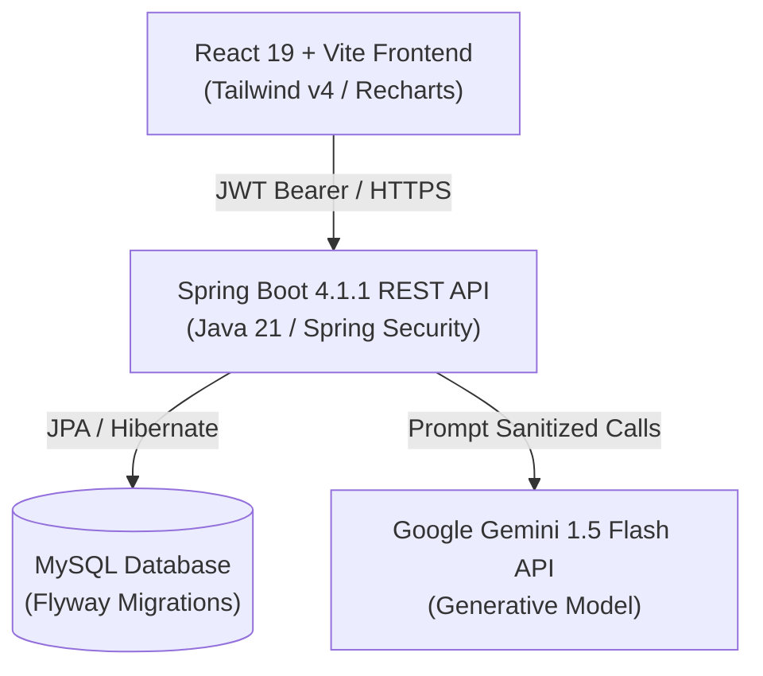

# IntervAI · AI Mock Interview & Career Coaching Platform

<div align="center">


[](https://vitejs.dev/)
[](https://react.dev/)
[](https://tailwindcss.com/)
[](https://spring.io/projects/spring-boot)
[](https://openjdk.org/)
[](https://www.mysql.com/)
[](LICENSE)

**Everything you need to ace your technical, system design, and behavioral interviews.**  
*Live speech-to-text recording, adaptive AI follow-ups, ATS resume matching, and instant multi-dimensional scorecards.*

[Live Demo](https://intervai.app) · [Report Bug](https://github.com/aaryanman29-beep/IntervAI/issues) · [Request Feature](https://github.com/aaryanman29-beep/IntervAI/issues)

</div>

---

## 📌 Overview

**IntervAI** is a full-stack, enterprise-grade mock interview coaching application modeled after leading tech prep platforms (such as Aced.io / Exponent). It bridges the gap between static practice problems and actual high-pressure interview loops by pairing real-time audio interaction with generative AI evaluation.

Whether preparing for **Software Engineering, System Design, Product Management, Machine Learning, or Engineering Leadership**, IntervAI provides realistic mock loops, adaptive follow-ups, and step-by-step career roadmaps.

---

## ✨ Key Features

- **🎙️ Real-Time Audio Practice & Speech Recognition**
  - Continuous speech-to-text with interim preview and audio-level detection.
  - Zero word-duplication streaming pipeline for natural candidate responses.

- **🤖 Adaptive AI Interviewer (Powered by Gemini AI)**
  - Evaluates candidate answers in real-time across four distinct dimensions:
    - **Technical Correctness**
    - **Communication Clarity**
    - **Depth & Edge Case Handling**
    - **Structured Delivery**
  - **Dynamic Follow-ups**: If your answer introduces a trade-off or needs clarification, the AI immediately asks an adaptive follow-up prompt.

- **📄 ATS Resume Intelligence & Skill Extraction**
  - Upload PDF/DOCX resumes to identify technical skills, experience gaps, and compute ATS parse compatibility.
  - Generates custom interview loops targeted directly at your project history.

- **📊 Comprehensive Scorecards & Skill Breakdown**
  - Visual metrics, radar charts, strengths/weaknesses breakdown, and model reference answers.

- **🎯 Curated Question Bank**
  - Searchable by topic, difficulty (*Easy, Medium, Hard*), and track (*System Design, Algorithms, Behavioral, SQL, Machine Learning*).
  - Personal bookmarking and practice state management.

- **🛡️ Production-Grade Security Hardening**
  - Stateless JWT token authentication with bcrypt password encryption.
  - In-memory sliding-window **Rate Limiting** to prevent brute-force attacks and prompt spamming.
  - **Account Lockout Service**: Automatic temporary lock after consecutive failed login attempts.
  - Prompt injection sanitization protecting generative AI models against prompt exploits.
  - Production HTTP security headers: `CSP`, `HSTS`, `X-Frame-Options`, `X-Content-Type-Options`, and `Referrer-Policy`.

---

## 🏗️ Architecture & Tech Stack



### Frontend
- **Framework**: React 19 + Vite 8
- **Styling**: Tailwind CSS v4 with custom Aced.io-inspired design system tokens
- **Typography**: Inter (Body) + Plus Jakarta Sans (Headings) + JetBrains Mono (Code)
- **Icons**: Lucide React
- **Data Visualization**: Recharts
- **Testing**: Vitest + React Testing Library + JSDOM

### Backend
- **Framework**: Spring Boot 4.1.1 (Java 21)
- **Security**: Spring Security 7 + JWT + BCrypt + Custom Rate Limiter
- **Database**: MySQL with Flyway Database Versioning
- **AI Integration**: Google Gemini 1.5 Flash API via Spring RestTemplate + Jackson
- **Build Tool**: Maven (`mvnw` wrapper included)
- **Testing**: JUnit 5 + Mockito + Spring Boot Test

---

## 🚀 Quick Start Guide

### Prerequisites
- **Node.js**: `v20.x` or `v22.x` (pnpm or npm)
- **Java**: OpenJDK `21`
- **MySQL**: `8.x`, `9.x`, or `26.x`
- **Gemini API Key**: [Google AI Studio](https://aistudio.google.com/) (Optional: graceful fallback included if omitted)

---

### 1. Clone Repository
```bash
git clone https://github.com/aaryanman29-beep/IntervAI.git
cd IntervAI
```

---

### 2. Configure Backend
Create an environment file or export variables:
```bash
# In backend/src/main/resources/application.yml or system environment
export SPRING_DATASOURCE_URL="jdbc:mysql://localhost:3306/intervAI?useSSL=false&allowPublicKeyRetrieval=true&serverTimezone=Asia/Kolkata"
export SPRING_DATASOURCE_USERNAME="root"
export SPRING_DATASOURCE_PASSWORD="YourPassword"
export JWT_SECRET="your-256-bit-hex-secret-key-at-least-64-characters-long"
export GEMINI_API_KEY="your-gemini-api-key"
```

Start the backend:
```bash
cd backend
./mvnw clean spring-boot:run
```
*Backend runs on `http://localhost:8080`.*

---

### 3. Configure Frontend
In the root directory, create `.env.local`:
```bash
VITE_API_URL=http://localhost:8080/api
```

Install dependencies and start development server:
```bash
npm install
npm run dev
```
*Frontend runs on `http://localhost:8443` (or `http://localhost:5173`).*

---

## 🧪 Testing

### Frontend Tests
```bash
npm run test
```
*Executes unit and integration test suites using Vitest.*

### Backend Tests
```bash
cd backend
./mvnw test
```
*Runs all 16 JUnit 5 / SpringBoot unit and integration tests.*

---

## 🐳 Docker Deployment

A multi-stage `Dockerfile` and `docker-compose.yml` are provided for containerized deployment:

```bash
docker compose up -d --build
```

This spins up:
- **`intervai-frontend`**: Production NGINX web server serving optimized Vite bundle on port `80`/`443`.
- **`intervai-backend`**: Spring Boot container on port `8080`.
- **`intervai-db`**: MySQL container with persistent volume and health check.

---

## 🌐 Production Deployment Options

| Service | Recommended Platform | Notes |
| :--- | :--- | :--- |
| **Frontend** | Vercel / Cloudflare Pages / AWS S3 + CloudFront | Set build command: `npm run build`, output: `dist` |
| **Backend** | AWS ECS / Google Cloud Run / Render / Railway | Containerized Spring Boot JAR |
| **Database** | AWS RDS / PlanetScale / Supabase MySQL | Automated backups and SSL connections |

---

## 🔒 Security & Compliance

- **CORS Configuration**: Restricts access to authorized frontend domains.
- **Data Protection**: Passwords hashed with BCrypt (cost factor 10); JWT tokens stored securely.
- **Input Sanitization**: Strip dangerous HTML and prompt injection vectors before processing.
- **Rate Limiting**: Sliding-window rate limiters prevent endpoint abuse.
- **Cookies & Privacy**: Compliant with GDPR/CCPA with consent banners and privacy preference controls.

---

## 🤝 Contributing

Contributions are always welcome!
1. Fork the Project.
2. Create your Feature Branch (`git checkout -b feature/AmazingFeature`).
3. Commit your Changes (`git commit -m 'feat: add AmazingFeature'`).
4. Push to the Branch (`git push origin feature/AmazingFeature`).
5. Open a Pull Request.

---

## 📄 License

Distributed under the MIT License. See `LICENSE` for more information.

---

<div align="center">
  <sub>Built with ❤️ by <a href="https://github.com/aaryanman29-beep">Aaryan</a> and the IntervAI Team. Practice with confidence.</sub>
</div>
